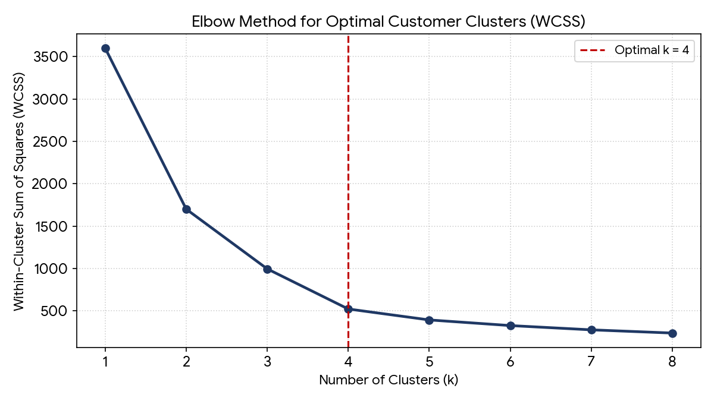
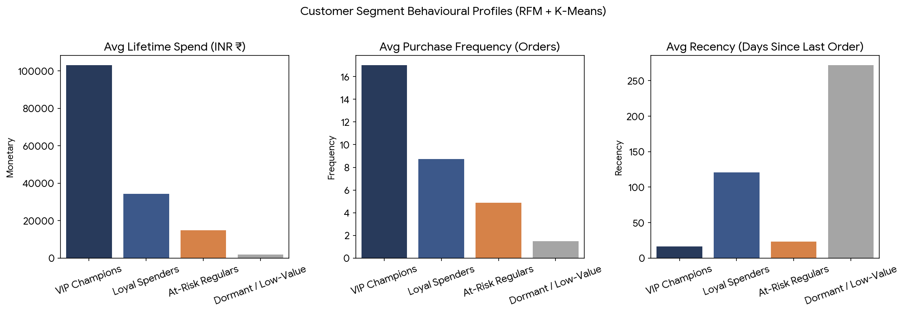

# Customer Segmentation Analysis (Python & SQL)

[]()
[]()
[]()

## Overview
An end-to-end **Customer Segmentation** project combining **SQL** (for RFM feature extraction and quintile scoring) and **Python** (for unsupervised **K-Means clustering** and behavioural profiling) on Indian retail e-commerce transactions (INR ₹).

---

## Repository Structure
```text
customer-segmentation-rfm-kmeans/
├── data/
│   ├── retail_transactions.csv       # Raw transactional dataset (1,200 customers)
│   └── segmented_customers.csv       # Output customer table with RFM metrics & K-Means segments
├── sql/
│   └── rfm_segmentation.sql          # CTE & NTILE() SQL queries for RFM scoring & cohort summaries
├── src/
│   └── customer_segmentation.py      # Python K-Means clustering & evaluation pipeline
├── images/
│   ├── elbow_curve.png               # WCSS Elbow curve justifying k=4 clusters
│   └── segment_profiles.png          # Behavioural comparison across customer segments
└── README.md
```

---

## Methodology
1. **SQL Feature Engineering (`sql/rfm_segmentation.sql`):**
   - Aggregated raw order logs into **Recency** (days since last purchase), **Frequency** (distinct order count), **Monetary** (total spend in ₹), **Average Order Value (AOV)**, and **Discount Sensitivity**.
   - Applied `NTILE(5)` window functions to assign 1–5 RFM scores and rule-based cohort labels.
2. **Unsupervised Machine Learning (`src/customer_segmentation.py`):**
   - Applied `np.log1p()` transformation to handle right-skewed Monetary and Frequency distributions, followed by `StandardScaler`.
   - Validated optimal cluster count ($k = 4$) using the **Elbow Method (WCSS)** and **Silhouette Score**.

---

## Customer Segments & Marketing Strategy

| Segment | Behavioural Profile | Recommended Action |
| :--- | :--- | :--- |
| **VIP Champions** | Highest spend, frequent orders, purchased within 30 days | Early access to new launches, zero-discount loyalty perks, referral rewards |
| **Loyal Spenders** | Consistent repeat buyers with strong AOV | Cross-sell higher-margin categories (Electronics, Home & Kitchen) |
| **At-Risk Regulars** | Historically high spenders who haven't ordered in 110–240 days | Automated win-back campaigns with targeted UPI/card cashback offers |
| **Dormant / Low-Value** | Infrequent, low-ticket buyers with high recency | Low-cost automated email/push reactivation; avoid high CAC ad spend |

---

## Visual Insights



---

## How to Run
```bash
pip install pandas numpy scikit-learn matplotlib seaborn
python src/customer_segmentation.py
```
